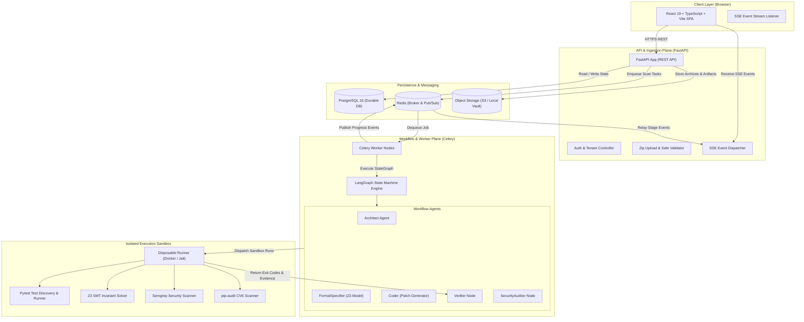
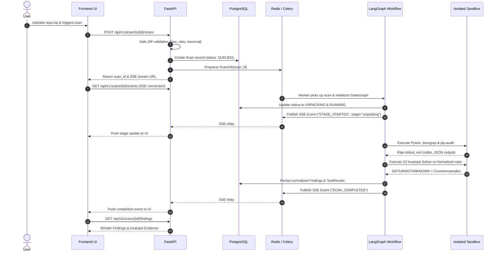

# Neuro-Symbolic Software Foundry — System Architecture

**Document Version:** 1.0.0  
**Status:** Approved Architectural Blueprint Baseline  
**Workspace:** `C:\Users\Hanan\OneDrive\Desktop\n`

---

## 1. System Topology & Logical Architecture

The system decouples synchronous request handling, asynchronous long-running scans, workflow agent state machines, and untrusted execution sandboxes:



---

## 2. Component Separation & Boundaries

### 2.1 Frontend Single Page Application (React 19 + TypeScript + Vite)
- **Deployment:** Compiled static assets (`dist/`) hostable on standard Linux hosting, Vercel, Netlify, or AWS CloudFront/S3.
- **Responsibility:** User interface, upload drag-and-drop, scan stage stepper, filterable findings matrix, side-by-side diff review, and report export.
- **Strict Boundary:** No direct communication with workers, database, or LLM providers. All communication routes through FastAPI `/api/v1/*`.

### 2.2 API Layer (FastAPI)
- **Role:** Synchronous ingress, authentication (JWT/OAuth), project metadata management, upload security validation, scan initialization, and SSE event streaming.
- **Strict Boundary:** Never executes scanned project code, test runners, or heavy AI workflows in the API request lifecycle. Dispatches all long-running tasks to Celery.

### 2.3 Task Queue & Pub/Sub (Celery + Redis)
- **Role:** Distributed background job queue. Handles retry ceilings, rate limits, timeout enforcement, and progress pub/sub messaging.
- **Strict Boundary:** Redis serves as an ephemeral message broker and cache; durable state is strictly committed to PostgreSQL.

### 2.4 Workflow State Machine (LangGraph)
- **Role:** Orchestrates the multi-agent decision cycle:
  - `Architect`: Analyzes project manifest and selects verification targets.
  - `FormalSpecifier`: Maps target logic to mathematical invariant constraints.
  - `Verifier`: Coordinates test execution and SMT constraint proofs.
  - `SecurityAuditor`: Triggers static and supply chain scans.
  - `Coder`: Proposes surgical diff patches upon failure.
- **Strict Boundary:** Evaluates structured data only; all tool executions take place in isolated runner processes.

### 2.5 Isolated Execution Sandbox (Runner)
- **Role:** Executes untrusted user code, unit tests, and security scans.
- **Constraints:**
  - Non-root user execution (`uid 10001:10001`).
  - Read-only root filesystem with an ephemeral `/tmp` volume.
  - Default drop of all Linux capabilities (`CAP_DROP ALL`).
  - Strict CPU (max 2 cores), Memory (max 2GB), and PIDs (max 100) quotas.
  - Outbound network egress disabled (`--network none`) except for designated pre-fetch steps.

---

## 3. Scan Lifecycle & Data Flow



---

## 4. LangGraph State Machine Specification

The scan execution workflow is modeled as a stateful graph:

```python
class FoundryWorkflowState(TypedDict):
    scan_id: str
    project_id: str
    repo_path: str
    detected_framework: str
    selected_checks: list[str]
    current_stage: str
    pytest_results: Optional[dict]
    semgrep_findings: list[dict]
    audit_findings: list[dict]
    z3_results: list[dict]
    active_findings: list[dict]
    patch_proposal: Optional[dict]
    approval_granted: bool
    retry_count: int
    error: Optional[str]
```

### Graph Transitions:
1. `detect_environment` -> `run_static_scans` & `run_tests` (parallel or staged)
2. `run_formal_verification` -> evaluates Z3 SMT invariants
3. `aggregate_findings` -> normalizes outputs and determines overall status
4. **Conditional Branch:** If findings exist and user requests patch -> `propose_patch` -> `wait_for_human_approval`
5. On approval -> `apply_patch_working_copy` -> `re_verify` -> `finalize_report`
